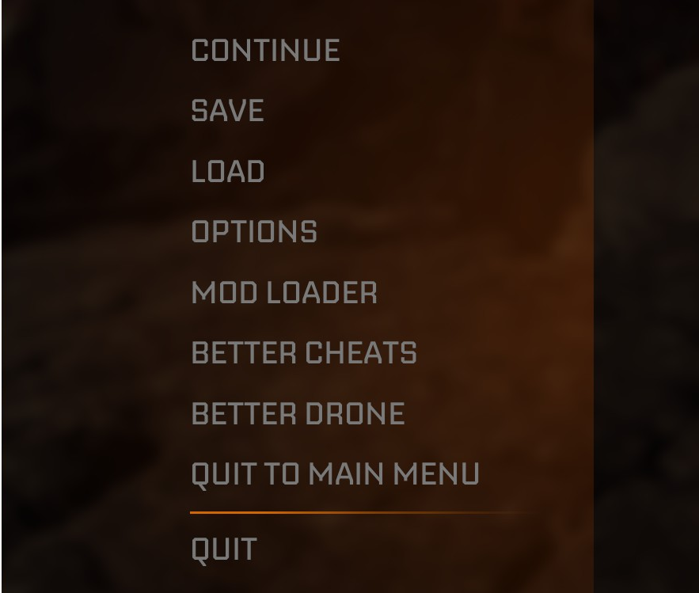
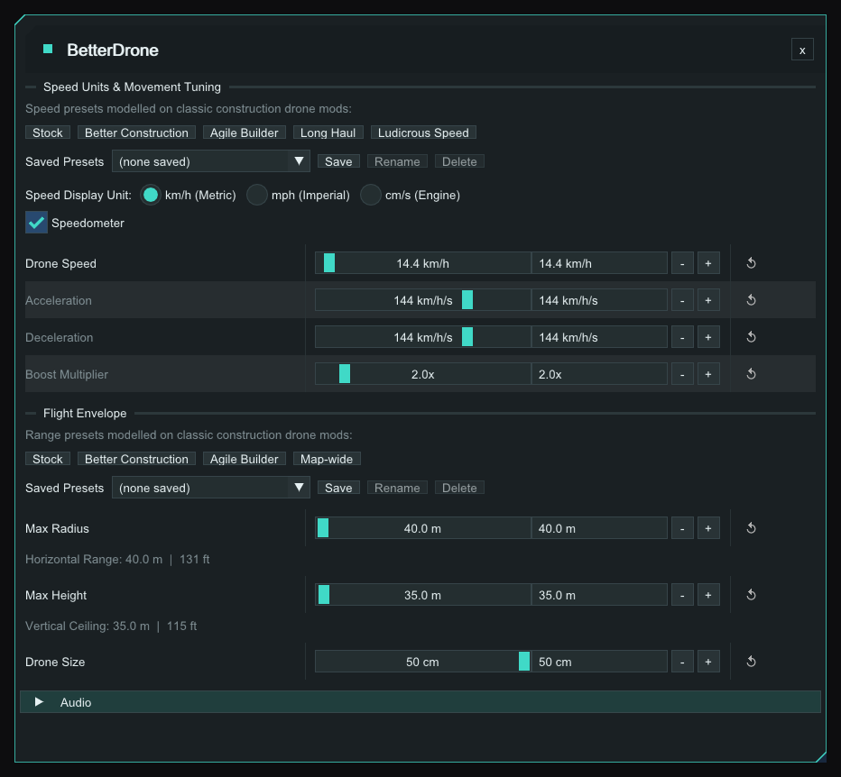
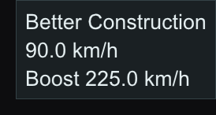
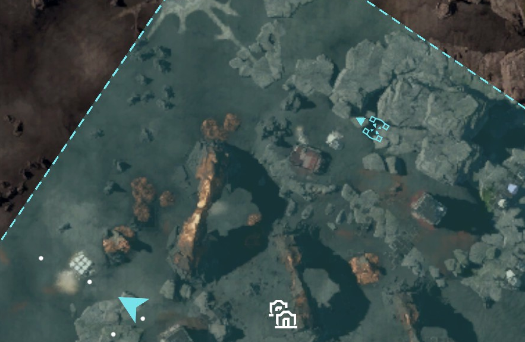
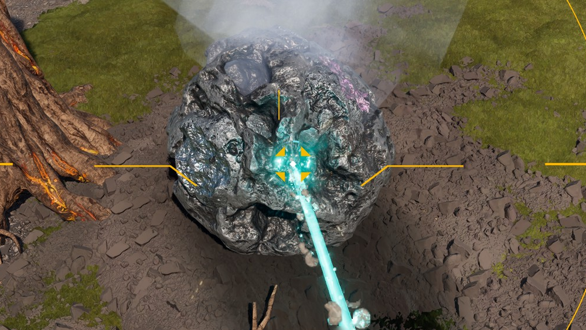
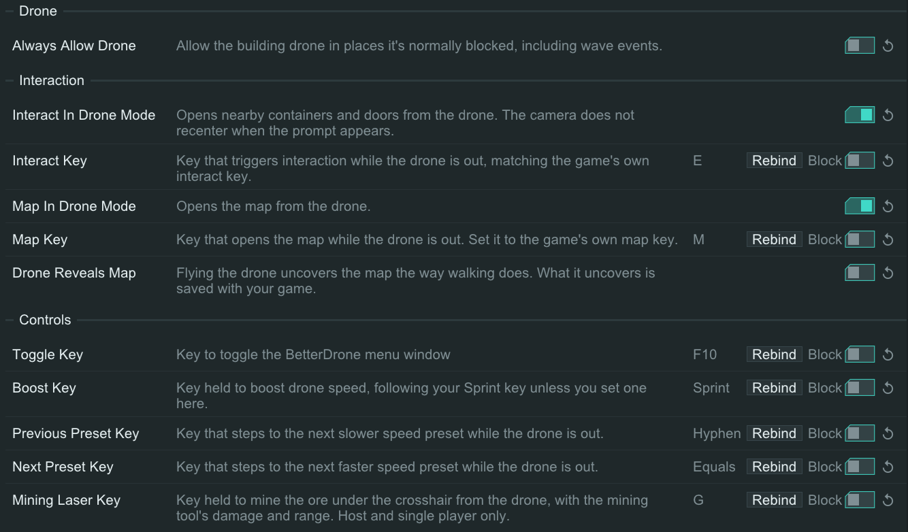

# BetterDrone — StarRupture Client Plugin

Extends the building drone limits in [StarRupture](https://store.steampowered.com/app/1631270/StarRupture/) beyond their default values, and adds drone controls and tools.

**Target:** Game client only

---

## What It Does

Patches the game's drone developer settings CDO at runtime to apply your configured values each session: Speed (cm/s), Max Radius and Max Height (cm). The warning thresholds follow at 95% of the max values. Stock values return when the plugin unloads. `Always Allow Drone` lets you use the drone where it's normally blocked, including during wave events.

### The BetterDrone panel [✦](#msantoro12)

Opens with **F10** (rebindable on the loader's Config page, Controls), the **BETTER DRONE** row under OPTIONS in the pause menu, or the **BetterDrone** button under Plugin Tools on the loader's config page. **Esc** or **Q** closes it. Game sessions only.

- **Rows:** Drone Speed, Acceleration, Deceleration, Boost Multiplier, Slow Multiplier, Max Radius, Max Height, Drone Size, and a collapsed Audio section (Master, Idle, Movement, Rotation, Station volume; Master sets the rest). Each has a slider, a number box (typed values clamp to the ranges below) and a reset arrow (default; the game's own value for speed, radius and height).
- **Drone Size:** the drone's collision radius, 20 to 50 cm (stock 50). A smaller drone fits through ladder holes and gaps. Its weight stays the same, so speed does not change with size. [✦](#msantoro12)
- **Speed Display Unit:** **km/h** (default), **mph** or **cm/s** (1000 cm/s = 36 km/h = 22.4 mph). Sets the speed, acceleration (km/h/s, mph/s, cm/s²) and range (m, ft, cm) rows, the toast, the speedometer, and the HUD's distance and height readouts, which show in feet with **mph** and in metres otherwise.
- **Speedometer** (on by default): the drone's speed under the HUD's distance readout, its number lined up with the distance digits and its unit under the "m", so it keeps its place as the numbers change, in the readout's own font. While it shows, the HUD's ring stays centred on the crosshair whatever the distance and height read. [✦](#msantoro12)
- **Saved presets:** Save, Rename, Delete (asks first), for speed and range. Save with a saved preset selected asks "You're saving over <name>. Continue?" and overwrites it; with none or a built-in selected it adds a new, named-for-you entry. Built-in names are reserved. The dropdown and the hotkeys use the first 16 per group, A-Z. Names up to 64 characters.

| Preset | Speed (cm/s) | Boost | Accel / decel (cm/s²) | Max Radius (cm) | Max Height (cm) |
|---|---|---|---|---|---|
| Stock | game's own (400) | 2x | 4000 | game's own (4000) | game's own (3500) |
| Better Construction | 2500 | 2.5x | 5000 | 10000 | 5000 |
| Agile Builder | 4000 | 3x | 10000 | 20000 | 10000 |
| Long Haul | 5000 | 3x | 12000 | | |
| Ludicrous Speed | 8000 | 4x | 20000 | | |
| Map-wide | | | | 1000000 | 500000 |

Speed presets cover the first three columns, range presets the last two. Stock reads the game's own speed and range when the game starts; the game has no boost or ramp, so those are BetterDrone's. Better Construction and Map-wide follow CrazyCovin's Better Construction Drone mod.

### Boost [✦](#msantoro12)

Hold the boost key (default: your game's Sprint key, rebinds included; LeftShift if unreadable; rebindable on the loader's Config page, Controls) to multiply speed by Boost Multiplier (1 to 10x, default 2x), up to 20000 cm/s. Acceleration and deceleration ramp it on and off. A new base speed applies at once.

### Slow [✦](#msantoro12)

Hold the slow key (default: LeftControl; rebindable on the loader's Config page, Controls) to fly at Slow Multiplier (0.05 to 1x, default 0.25x) of your speed, for when you need to creep. Acceleration and deceleration ramp it on and off. With Boost held too, Slow wins: speed is the base speed times Slow Multiplier. If the game's own drone Up or Down key is the same key, BetterDrone logs a warning; pick another.

### Preset hotkeys and toast [✦](#msantoro12)

While the drone is out, **-** and **=** (rebindable on the loader's Config page, Controls) step to the next slower and faster speed preset, through the built-in and saved presets in speed order. A toast at the top right shows the name, speed and Boost speed, in the panel's unit, for 1.5 s.

At either end the toast shows where you are. Off every preset, a step goes to the nearest one in that direction ("Custom" if none). Stepping to a saved preset selects it in the panel. Ignored on foot, with a menu open or with the panel open.

### Interacting from the drone

Fly up to a building, look at it and press the interact key (**E**; rebindable on the loader's Config page, Interaction) to open its UI, as you would on foot. It also works in delete mode, and gathers wild plants, fruit and eggs (host and single player only).

Hold the game's context interact key (**E** by default, rebinds included) on a building or a logistics drone for as long as the game asks you to on foot, and it takes everything the target holds, as holding it does on foot. A short press stays the plain interact. [✦](#msantoro12)

### Hotbar page from the drone [✦](#msantoro12)

Hold **Ctrl** and scroll the mouse wheel while the drone is out to switch your hotbar page, one page per notch, as Ctrl and the wheel do on foot. It changes the page only, never the slot or the tool in your hand, so the drone stays out. It needs a game version that has hotbar pages; on an older one Ctrl and the wheel are left to the game. The wheel is taken only while you fly, so Ctrl and the wheel work as before on foot, with a menu open or with a loader window open. Only the wheel is taken, so Ctrl itself still reaches the game and any key bound to it. Ctrl is also the default Slow key, so the drone slows while you scroll; rebind Slow Key on the Config page if you prefer. A mod that also uses Ctrl and the wheel, such as a minimap zoom, loses those notches while the drone is out if BetterDrone loads before it.

### The map from the drone [✦](#msantoro12)

- **Open it:** the map key (**M**; rebindable on the loader's Config page, Interaction) opens the map while you fly and closes it again, never over another menu.
- **Follow:** the map opens centred on the drone and keeps it centred as you fly; zoom works as usual. Pan the map by hand (mouse drag, arrow keys, gamepad or the Center on player button) and it stops following until you reopen it or press the map centre key. That key (**C**, the game's Center on player key; rebindable on the Config page, Interaction, and best set to match the game's) keeps the map on your character; press it again to follow the drone. Only the keyboard key toggles; the Center on player button and the gamepad count as panning. When the drone is recalled the map goes back to centring on your character, unless you moved it.
- **Marker:** the drone gets its own, a small targeting reticle in your player-arrow colour (cyan if unreadable) that turns with the drone and keeps its size at any zoom. The game's arrow stays at your parked body. No setting. It hides if the map can't be matched to the game's markers, and stays off until RELOAD after a fault.
- **Reveal:** `Drone Reveals Map` (off by default) uncovers the map as you fly, at the walking radius and spacing, upgrades included. Saved with your game. Not inside the Forgotten Engine.

### Mining from the drone [✦](#msantoro12)

Hold **G** (rebindable on the loader's Config page, Controls) while flying to mine the ore under the crosshair: meteor ores, their chunks and infinite ore veins. Range, damage, fire rate, heat, beam and sounds all follow the mining tool; yield goes to your inventory. Host and single player only.

- **Stops** on release, a new or lost target, recall, an open menu or death. After a full inventory, press again. After an overheat it stays locked until the heat has drained (about 97 s for the laser) or been vented.
- **Aim:** a 25 cm sphere catches small ore beside the crosshair. The target holds 0.35 s through a miss.
- **Heat:** one stack per 0.2 s, overheat at 100. Cooling starts after 8 s (15 s after an overheat), then one stack per 0.82 s.
- **Heat ring:** around the crosshair, filling clockwise from 12 o'clock in your marker colour, orange by 75%, red by 90%. Dims while cooling holds, shrinks as it drains, pulses from 85%, flashes red while locked out.
- **Vent:** press the game's Reload key (R unless rebound) in the drone to vent the heat as the mining tool's R does: the vent takes 0.04 s per stack, plus 4 s when overheated (8 s from a full, overheated laser), the stacks coming off evenly, and the overheat ends with the last one. It does nothing with no heat or while firing, and firing stops a vent that is not overheated. The timing is read from the game's forced cooldown ability. The vent is silent.
- **Drill:** its heat is read, never changed; the unlimited heat tag (BetterCheats' No Handheld Drill Overheat) means no heat. Fire rate follows the drill's bonuses as last seen in hand. BetterCheats' Mining Damage, Range, Hit Rate and Overheat Cooldown rows apply.

### Floor guard

With the range above stock, flying far out can unload the floor under your parked character. If it falls straight down from its spot (100 cm or more while the drone is out, any fall after return), it is held there until the floor is back, then set down walking. It gives up after 10 s. Walking ends the hold only after 3 s, so a key held while recalling doesn't drop you; jumping or a knockback after the set-down ends it. No setting.

### Keep area around body loaded [✦](#msantoro12)

The game loads the world around the view, and in the drone the view is the drone. Fly far out and the ground around your parked character unloads, so the world is gone when you come back and streams in again. While the drone is out, BetterDrone gives your character one of the game's own streaming sources (the kind teleporters use) with a small round shape, so the area within `Body Area Radius` of your body stays loaded and active. The default is 40 m, the game's own drone range, which the stock drone never unloads. It is removed when the drone comes back, on turning the setting off, on death, world exit and RELOAD.

Cost: memory and some actor ticks for that area, about what standing there costs. It adds no GPU time, since that area is beyond the drone's view. Turn it off with `Keep Area Around Body Loaded` if you would rather not pay for it.

### System voice from the drone [✦](#msantoro12)

The game's system voice (rupture warnings and the other spoken lines) plays from your parked character, so it fades out as the drone flies away. While the drone is out, BetterDrone turns off the distance falloff on the attenuation settings the game plays those lines with, so they stay audible far from your body, and puts them back when the drone is recalled. The game has one such setting for first person and one for third person, and other players' characters may share the third-person one. So when other players are in the game, BetterDrone leaves that one alone, and the voice may still fade when the drone is far out. No setting.

### Wave shelter [✦](#msantoro12)

You can fly the drone outside during a wave while your character stays safe in the shelter and won't die. Shelter is judged at your character's body, not at the drone, and shelter built or deconstructed around it mid-flight counts at once. With `Always Allow Drone` off, the stock rule that ends the drone in an interior follows your character too, so flying the drone into one no longer ends it. No setting.

---

## Configuration

Config is stored in `Plugins\config\BetterDrone.ini` and is generated on first launch. Edit it in-game via the ModLoader config editor (default key: **F2**); changes apply live, keys included. Hand edits to any file need a restart or RELOAD.

| Section | Key | Default | Description |
|---|---|---|---|
| `[Drone]` | `Always Allow Drone` | `false` | Drone allowed where blocked |
| `[Drone]` | `Keep Area Around Body Loaded` | `true` | Keeps the ground around your parked character loaded while the drone is out |
| `[Drone]` | `Body Area Radius` | `40` | Metres kept loaded (20 to 200); 40 is the stock drone range |
| `[Interaction]` | `Interact In Drone Mode` | `true` | Interact from the drone |
| `[Interaction]` | `Interact Key` | `E` | Match your game's interact key |
| `[Interaction]` | `Map In Drone Mode` | `true` | Map from the drone |
| `[Interaction]` | `Map Key` | `M` | Match your game's map key |
| `[Interaction]` | `Map Centre Key` | `C` | Match your game's Center on player key |
| `[Interaction]` | `Drone Reveals Map` | `false` | Flying uncovers the map |
| `[Controls]` | `Toggle Key` | `F10` | Panel (BetterCheats' default too) |
| `[Controls]` | `Boost Key` | `Sprint` | Held to boost; `Sprint` follows your Sprint key |
| `[Controls]` | `Slow Key` | `LeftControl` | Held to slow down; wins over Boost |
| `[Controls]` | `Previous Preset Key` | `Hyphen` | Slower speed preset |
| `[Controls]` | `Next Preset Key` | `Equals` | Faster speed preset |
| `[Controls]` | `Mining Laser Key` | `G` | Held to mine |

Panel values are saved to `Plugins\config\BetterDrone-Panel.ini`, clamped to these ranges. Values in an older `BetterDrone.ini` move over on first run.

| Section | Key | Range | Default |
|---|---|---|---|
| `[Drone]` | `SpeedPerSec` | 1 to 20000 cm/s | the game's own (400) |
| `[Drone]` | `MaxRadius` | 100 to 1000000 cm | the game's own (4000) |
| `[Drone]` | `MaxHeight` | 100 to 500000 cm | the game's own (3500) |
| `[Drone]` | `SphereRadius` | 20 to 50 cm | `50` |
| `[Controls]` | `BoostMultiplier` | 1 to 10 | `2` |
| `[Controls]` | `SlowMultiplier` | 0.05 to 1 | `0.25` |
| `[Controls]` | `Acceleration`, `Deceleration` | 4000 to 50000 cm/s² | `4000` |
| `[Audio]` | `IdleVolume`, `MovementVolume`, `RotationVolume`, `StationVolume` | 0 to 1 | `1` |
| `[UI]` | `SpeedUnit` | `km/h`, `mph`, `cm/s` | `km/h` |

Saved presets are in `Plugins\config\BetterDrone-Presets.ini`: `[Speed:<name>]` (`speedPerSec`, `boostMultiplier`, `acceleration`, `deceleration`) and `[Range:<name>]` (`maxRadius`, `maxHeight`).

---

## Installation

1. Download the latest release ZIP from the [Releases](../../releases) page:
   - `BetterDrone-Client-*.zip`

2. Extract into your game's `Binaries\Win64\ModLoader\` folder. The ZIP contains a `Plugins\` folder, so the DLL lands in `ModLoader\Plugins\`.

3. After the first launch, set your values in the BetterDrone panel, or edit the INI files above.

> **Requires [StarRupture-ModLoader](https://github.com/AlienXAXS/StarRupture-ModLoader) v1.23.0 or later** (interface v75) to be installed first.

---

## Troubleshooting

Found a bug? [Report it on GitHub](https://github.com/AlienXAXS/StarRupture-Plugin-BetterDrone/issues) and attach your `ModLoader.log` (in `<game>\StarRupture\Binaries\Win64\ModLoader\Logs\`).

| Problem | Solution |
|---|---|
| Values not changing | Check `ModLoader.log` in `Binaries\Win64\ModLoader\Logs\` for errors. |
| Plugin not loading | Confirm ModLoader is installed and `BetterDrone.dll` is in `Plugins\`. |
| Mining laser does nothing | Drone mode, host or single player only. Full inventory: press again. Overheated: wait for the ring to clear. |

---

## Building from Source

Requires Visual Studio 2022 and the [StarRupture-Plugin-SDK](https://github.com/AlienXAXS/StarRupture-Plugin-SDK).

Clone the repo, open `BetterDrone.sln`, and build the `Client Release|x64` configuration. The output DLL will be placed in `build\Client Release\Plugins\`.

---

## Disclaimer

Use at your own risk. The authors are not responsible for any damage caused by using this software.

---

## Credits

Original mod by [@AlienXAXS](https://github.com/AlienXAXS).

Maintained by [@msantoro12](https://github.com/msantoro12).

Contributors:

- ✦ [@msantoro12](https://github.com/msantoro12), creator of [StarRupture Planner](https://starrupture.goodstuff.software)
