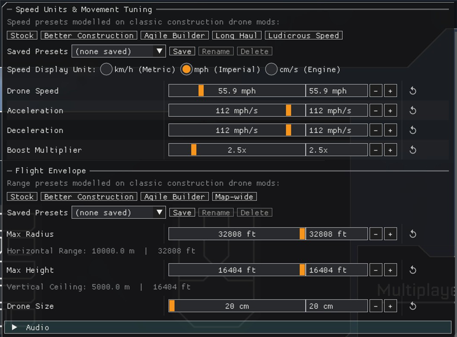
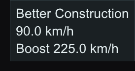
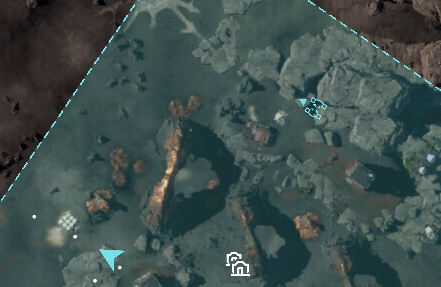
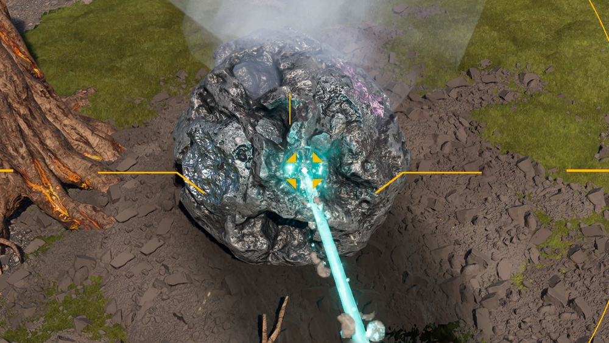
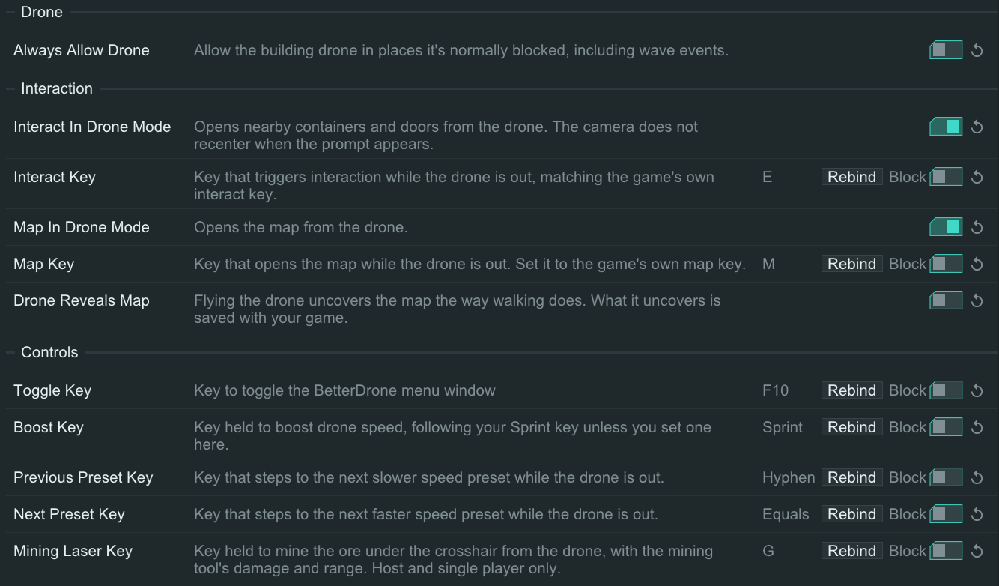

# BetterDrone — StarRupture Client Plugin

Extends the building drone limits in [StarRupture](https://store.steampowered.com/app/1631270/StarRupture/) beyond their default values, and adds drone controls and tools.

**Target:** Game client only

---

## What It Does

Patches the game's drone developer settings CDO at runtime to apply your configured values each session: Speed (cm/s), Max Radius and Max Height (cm). The warning thresholds follow at 95% of the max values. Stock values return when the plugin unloads. `Always Allow Drone` lets you use the drone where it's normally blocked, including during wave events.

### The BetterDrone panel [✦](#msantoro12)

Opens with **F10** (rebindable on the loader's Config page, Controls), the **BETTER DRONE** row under OPTIONS in the pause menu, or the **BetterDrone** button under Plugin Tools on the loader's config page. **Esc** or **Q** closes it. Game sessions only.

- **Rows:** Drone Speed, Acceleration, Deceleration, Boost Multiplier, Max Radius, Max Height, and a collapsed Audio section (Master, Idle, Movement, Rotation, Station volume; Master sets the rest). Each has a slider, a number box (typed values clamp to the ranges below) and a reset arrow (default; the game's own value for speed, radius and height).
- **Speed Display Unit:** **km/h** (default), **mph** or **cm/s** (1000 cm/s = 36 km/h = 22.4 mph). Sets the speed, acceleration (km/h/s, mph/s, cm/s²) and range (m, ft, cm) rows, and the toast.
- **Saved presets:** Save (named for you), Rename, Delete (asks first), for speed and range. Built-in names are reserved. The dropdown and the hotkeys use the first 16 per group, A-Z. Names up to 63 characters.

| Preset | Speed (cm/s) | Boost | Accel / decel (cm/s²) | Max Radius (cm) | Max Height (cm) |
|---|---|---|---|---|---|
| Stock | 1000 | 2x | 4000 | 5000 | 2000 |
| Better Construction | 2500 | 2.5x | 5000 | 10000 | 5000 |
| Agile Builder | 4000 | 3x | 10000 | 20000 | 10000 |
| Long Haul | 5000 | 3x | 12000 | | |
| Ludicrous Speed | 8000 | 4x | 20000 | | |
| Map-wide | | | | 1000000 | 500000 |

Speed presets cover the first three columns, range presets the last two. Better Construction and Map-wide follow CrazyCovin's Better Construction Drone mod.

### Boost [✦](#msantoro12)

Hold the boost key (default: your game's Sprint key, rebinds included; LeftShift if unreadable; rebindable on the loader's Config page, Controls) to multiply speed by Boost Multiplier (1 to 10x, default 2x), up to 20000 cm/s. Acceleration and deceleration ramp it on and off. A new base speed applies at once.

### Preset hotkeys and toast [✦](#msantoro12)

While the drone is out, **-** and **=** (rebindable on the loader's Config page, Controls) step to the next slower and faster speed preset, through the built-in and saved presets in speed order. A toast at the top right shows the name, speed and Boost speed, in the panel's unit, for 1.5 s.

At either end the toast shows where you are. Off every preset, a step goes to the nearest one in that direction ("Custom" if none). Stepping to a saved preset selects it in the panel. Ignored on foot, with a menu open or with the panel open.

### Interacting from the drone

Fly up to a building, look at it and press the interact key (**E**; rebindable on the loader's Config page, Interaction) to open its UI, as you would on foot. It also works in delete mode, and gathers wild plants, fruit and eggs (host and single player only).

### The map from the drone [✦](#msantoro12)

- **Open it:** the map key (**M**; rebindable on the loader's Config page, Interaction) opens the map while you fly and closes it again, never over another menu.
- **Marker:** the drone gets its own, a small targeting reticle in your player-arrow colour (cyan if unreadable) that turns with the drone and keeps its size at any zoom. The game's arrow stays at your parked body. No setting. It hides if the map can't be matched to the game's markers, and stays off until RELOAD after a fault.
- **Reveal:** `Drone Reveals Map` (off by default) uncovers the map as you fly, at the walking radius and spacing, upgrades included. Saved with your game. Not inside the Forgotten Engine.

### Mining from the drone [✦](#msantoro12)

Hold **G** (rebindable on the loader's Config page, Controls) while flying to mine the ore under the crosshair: meteor ores, their chunks and infinite ore veins. Range, damage, fire rate, heat, beam and sounds all follow the mining tool; yield goes to your inventory. Host and single player only.

- **Stops** on release, a new or lost target, recall, an open menu or death. After a full inventory, press again. After an overheat it stays locked until the heat has drained (about 97 s for the laser).
- **Aim:** a 25 cm sphere catches small ore beside the crosshair. The target holds 0.35 s through a miss.
- **Heat:** one stack per 0.2 s, overheat at 100. Cooling starts after 8 s (15 s after an overheat), then one stack per 0.82 s.
- **Heat ring:** around the crosshair, filling clockwise from 12 o'clock in your marker colour, orange by 75%, red by 90%. Dims while cooling holds, shrinks as it drains, pulses from 85%, flashes red while locked out.
- **Drill:** its heat is read, never changed; the unlimited heat tag (BetterCheats' No Handheld Drill Overheat) means no heat. Fire rate follows the drill's bonuses as last seen in hand. BetterCheats' Mining Damage, Range, Hit Rate and Overheat Cooldown rows apply.

### Floor guard

With the range above stock, flying far out can unload the floor under your parked character. If it falls straight down from its spot (100 cm or more while the drone is out, any fall after return), it is held there until the floor is back, then set down walking. It gives up after 10 s. Walking, jumping or a knockback ends it. No setting.

### Wave shelter [✦](#msantoro12)

You can fly the drone outside during a wave while your character stays safe in the shelter and won't die. Shelter is judged at your character's body, not at the drone, and shelter built or deconstructed around it mid-flight counts at once. With `Always Allow Drone` off the drone still ends in an interior, as in stock. No setting.

---

## Configuration

Config is stored in `Plugins\config\BetterDrone.ini` and is generated on first launch. Edit it in-game via the ModLoader config editor (default key: **F2**); changes apply live, keys included. Hand edits to any file need a restart or RELOAD.

| Section | Key | Default | Description |
|---|---|---|---|
| `[Drone]` | `Always Allow Drone` | `false` | Drone allowed where blocked |
| `[Interaction]` | `Interact In Drone Mode` | `true` | Interact from the drone |
| `[Interaction]` | `Interact Key` | `E` | Match your game's interact key |
| `[Interaction]` | `Map In Drone Mode` | `true` | Map from the drone |
| `[Interaction]` | `Map Key` | `M` | Match your game's map key |
| `[Interaction]` | `Drone Reveals Map` | `false` | Flying uncovers the map |
| `[Controls]` | `Toggle Key` | `F10` | Panel (BetterCheats' default too) |
| `[Controls]` | `Boost Key` | `Sprint` | Held to boost; `Sprint` follows your Sprint key |
| `[Controls]` | `Previous Preset Key` | `Hyphen` | Slower speed preset |
| `[Controls]` | `Next Preset Key` | `Equals` | Faster speed preset |
| `[Controls]` | `Mining Laser Key` | `G` | Held to mine |

Panel values are saved to `Plugins\config\BetterDrone-Panel.ini`, clamped to these ranges. Values in an older `BetterDrone.ini` move over on first run.

| Section | Key | Range | Default |
|---|---|---|---|
| `[Drone]` | `SpeedPerSec` | 1 to 20000 cm/s | `1000` |
| `[Drone]` | `MaxRadius` | 100 to 1000000 cm | `5000` |
| `[Drone]` | `MaxHeight` | 100 to 500000 cm | `2000` |
| `[Controls]` | `BoostMultiplier` | 1 to 10 | `2` |
| `[Controls]` | `Acceleration`, `Deceleration` | 4000 to 50000 cm/s² | `4000` |
| `[Audio]` | `IdleVolume`, `MovementVolume`, `RotationVolume`, `StationVolume` | 0 to 1 | `1` |
| `[UI]` | `SpeedUnit` | `km/h`, `mph`, `cm/s` | `km/h` |

Saved presets are in `Plugins\config\BetterDrone-Presets.ini`: `[Speed:<name>]` (`speedPerSec`, `boostMultiplier`, `acceleration`, `deceleration`) and `[Range:<name>]` (`maxRadius`, `maxHeight`).

---

## Installation

1. Download the latest release ZIP from the [Releases](../../releases) page:
   - `BetterDrone-Client-*.zip`

2. Extract into your game's `Binaries\Win64\ModLoader\` folder. The ZIP contains a `Plugins\` folder, so the DLL lands in `ModLoader\Plugins\`.

3. After the first launch, set your values in the BetterDrone panel, or edit the INI files above.

> **Requires [StarRupture-ModLoader](https://github.com/AlienXAXS/StarRupture-ModLoader)** to be installed first.

---

## Troubleshooting

| Problem | Solution |
|---|---|
| Values not changing | Check `ModLoader.log` in `Binaries\Win64\ModLoader\Logs\` for errors. |
| Plugin not loading | Confirm ModLoader is installed and `BetterDrone.dll` is in `Plugins\`. |
| Mining laser does nothing | Drone mode, host or single player only. Full inventory: press again. Overheated: wait for the ring to clear. |

---

## Building from Source

Requires Visual Studio 2022 and the [StarRupture-Plugin-SDK](https://github.com/AlienXAXS/StarRupture-Plugin-SDK).

Clone the repo, open `BetterDrone.sln`, and build the `Client Release|x64` configuration. The output DLL will be placed in `build\Client Release\Plugins\`.

---

## Disclaimer

Use at your own risk. The authors are not responsible for any damage caused by using this software.

---

## Credits

Original mod by [@AlienXAXS](https://github.com/AlienXAXS).

Contributors:

- ✦ [@msantoro12](https://github.com/msantoro12), creator of [StarRupture Planner](https://starrupture.goodstuff.software)
